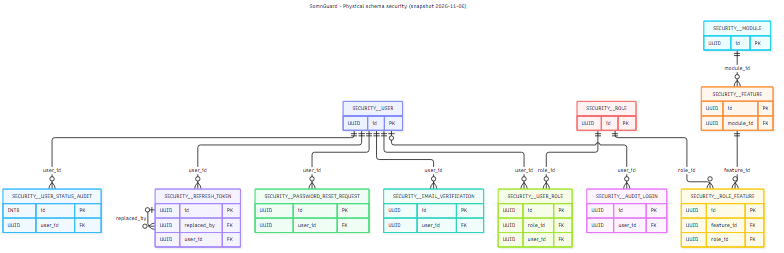
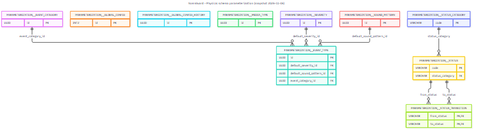
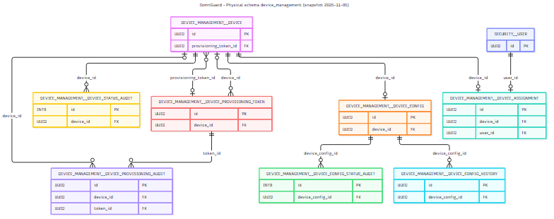
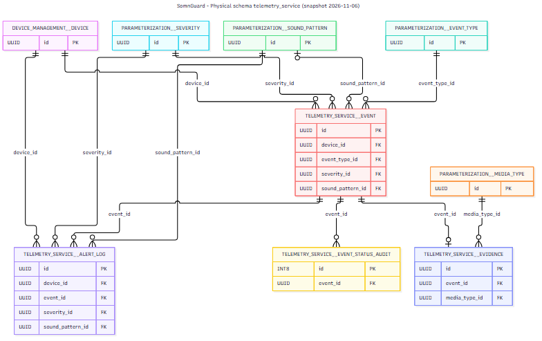
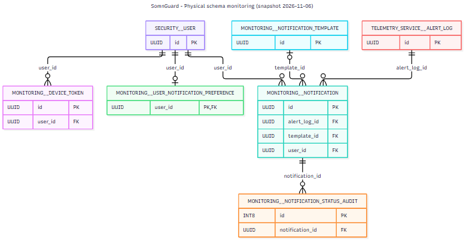

# Modelo físico de datos / Physical data model

**Fecha de captura:** 2026-11-06  
**Origen:** esquema de la instancia PostgreSQL local de SomnGuard, consultado en modo solo lectura.  
**Migraciones aplicadas:** 95 changesets; los tres últimos relevantes para esta revisión se ejecutaron el 2026-11-04. El checkout local de `somnguard-db` está en `fix/event-category-code-unique`, commit `36552d20016a88bc6a1b8adff6b0151f5c167727`.

## Alcance y método

Este documento registra el esquema físico aplicado en la instancia local. La consulta leyó únicamente metadatos de PostgreSQL; no exportó filas de usuarios, credenciales ni otra información de negocio. El diagrama muestra tablas y sus columnas de clave primaria y foránea. Para todas las columnas, tipos, valores por defecto, índices, restricciones y orden de aplicación, la fuente física completa es el conjunto de migraciones Liquibase del checkout local indicado arriba. El tag enlazado abajo sirve como referencia del código etiquetado, pero no coincide con todos los changesets aplicados en esta instancia.

Se observaron **38 tablas de aplicación**, **38 claves primarias**, **44 claves foráneas** y **10 restricciones únicas** en cinco esquemas de negocio. Hay además dos tablas de metadatos de Liquibase en `public`; se excluyen del modelo funcional. La arquitectura `analytics` no tiene tablas base en este snapshot y contiene las vistas materializadas `v_event_timeline` y `v_metrics_daily`.

> **Diferencia con el tag de entrega:** `code-tag/README.md` registra `final-delivery-2026` en el commit `e1af032352d114181392583a458a672585a5b127`. El checkout local tiene cambios posteriores en `01_ddl/04_alter/0000changelog.yaml` y en los changesets `025-ensure-event-category-code-unique`, `026-ensure-seed-conflict-keys` y `027-ensure-seed-required-defaults`. La instancia consultada registra esos tres changesets como ejecutados. Por tanto, este snapshot describe la base local y **no afirma ser una captura exacta del tag**.

## Inventario por esquema

| Esquema | Tablas físicas | Cantidad |
|---|---|---:|
| `security` (Security) | `audit_login`, `email_verification`, `feature`, `module`, `password_reset_request`, `refresh_token`, `role`, `role_feature`, `user`, `user_role`, `user_status_audit` | 11 |
| `parameterization` (Parameterization) | `event_category`, `event_type`, `global_config`, `global_config_history`, `media_type`, `severity`, `sound_pattern`, `status`, `status_category`, `status_transition` | 10 |
| `device_management` (Device Management) | `device`, `device_assignment`, `device_config`, `device_config_history`, `device_config_status_audit`, `device_provisioning_audit`, `device_provisioning_token`, `device_status_audit` | 8 |
| `telemetry_service` (Telemetry Service) | `alert_log`, `event`, `event_status_audit`, `evidence` | 4 |
| `monitoring` (Monitoring) | `device_token`, `notification`, `notification_status_audit`, `notification_template`, `user_notification_preference` | 5 |

## Mapa de relaciones físicas

El [diagrama global PNG](./diagrams/exports/03-physical-data-model.png) muestra las relaciones entre las 38 tablas; su [fuente Mermaid editable](./diagrams/source/03-physical-data-model.mmd) queda disponible para consulta. Para facilitar la lectura, separamos el detalle por esquema. Cada vista muestra las columnas PK/FK; las migraciones contienen el detalle de las demás columnas y restricciones.

### Security (`security`)

Fuente editable: [`03-physical-security-schema.mmd`](./diagrams/source/03-physical-security-schema.mmd).

<!-- PDF_PAGEBREAK -->

### Parameterization (`parameterization`)

Fuente editable: [`04-physical-parameterization-schema.mmd`](./diagrams/source/04-physical-parameterization-schema.mmd).

<!-- PDF_PAGEBREAK -->

### Device Management (`device_management`)

Fuente editable: [`05-physical-device-management-schema.mmd`](./diagrams/source/05-physical-device-management-schema.mmd).

<!-- PDF_PAGEBREAK -->

### Telemetry Service (`telemetry_service`)

Fuente editable: [`06-physical-telemetry-service-schema.mmd`](./diagrams/source/06-physical-telemetry-service-schema.mmd).

<!-- PDF_PAGEBREAK -->

### Monitoring (`monitoring`)

Fuente editable: [`07-physical-monitoring-schema.mmd`](./diagrams/source/07-physical-monitoring-schema.mmd).

## Relación con los modelos conceptuales y lógicos

La documentación fuente declara que `01-entity-relationship-model.mmd` y `02-relational-model.mmd` cubren 20 entidades de dominio, y que el segundo está en progreso. El diccionario de datos fuente es un borrador que declara 33 tablas. El esquema físico de la instancia local tiene 38 tablas de aplicación. Estas cifras describen alcances distintos y no se presentan como una equivalencia: queda pendiente conciliar el diccionario y el modelo lógico con el esquema implementado.

## Fuentes

- [Migraciones Liquibase del tag `final-delivery-2026`](https://github.com/SomnGuard/somnguard-db/tree/final-delivery-2026/01_ddl), como referencia del código etiquetado; ver arriba la diferencia con la instancia local.
- [README de arquitectura de datos en `somnguard-docs`](https://github.com/SomnGuard/somnguard-docs/blob/main/docs/06-data-architecture/README.md).
- [Modelo conceptual editable](./diagrams/source/01-entity-relationship-model.mmd).
- [Modelo relacional editable](./diagrams/source/02-relational-model.mmd).
