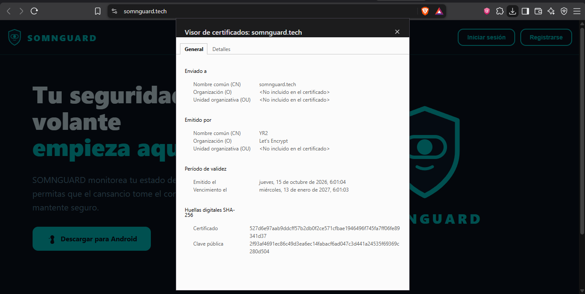
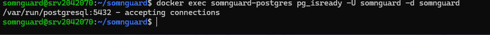
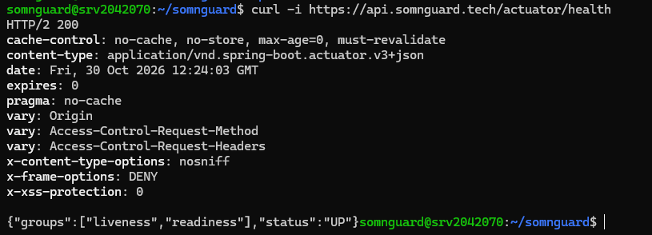
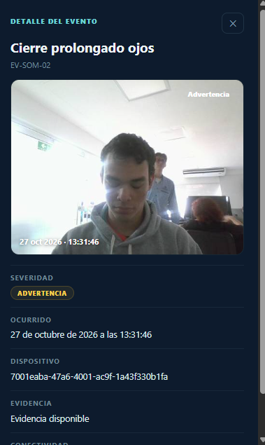
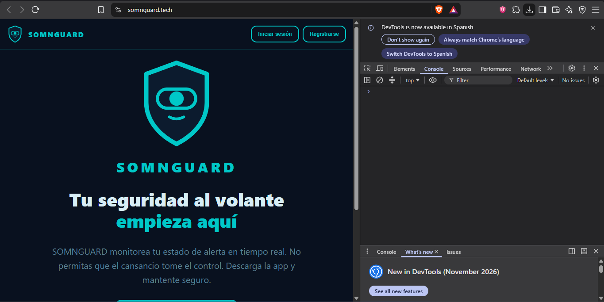
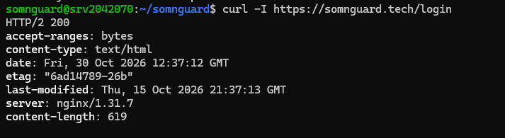
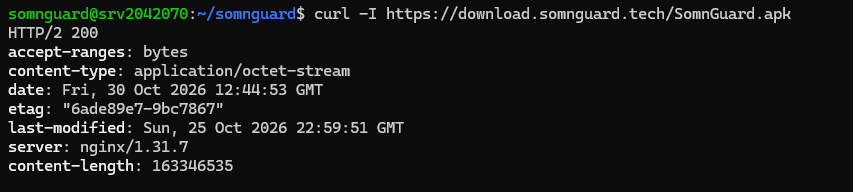
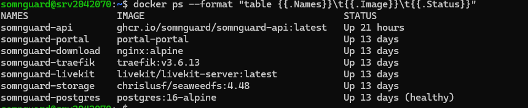
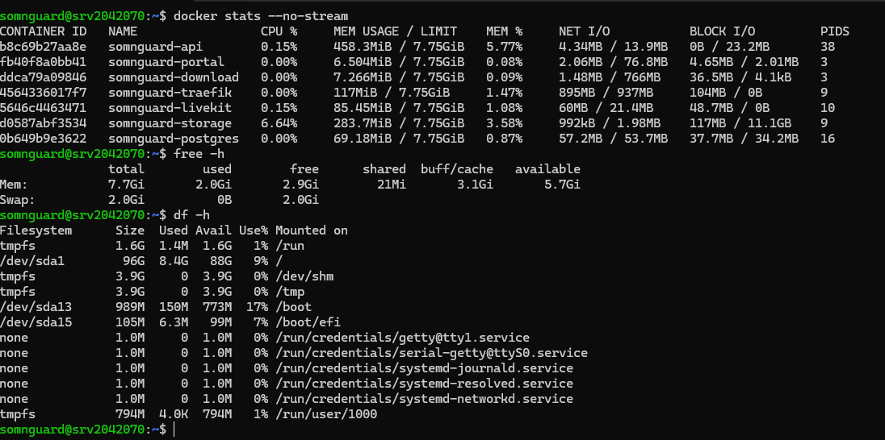

<div style="display:flex; align-items:center; justify-content:space-between;">

<div>

</div>

<div align="right">

# SOMNGUARD

## Manual de despliegue

**Estado:** Estable
**Fecha:** 2026-10-30

</div>

</div>

## Manual de despliegue — Base de datos, API, portal y servicios de plataforma

## Ficha del documento

| Detalle | Valor |
|---------|-------|
| Sistema | SomnGuard - DB / API / Portal |
| Versión del documento | 1.1 |
| Fecha de referencia | 16 de octubre de 2026 (manual técnico); evidencias de verificación del 30 de octubre de 2026 |
| Destino | VPS Ubuntu con Docker Compose |
| Ruta base del servidor | `/home/somnguard/somnguard/` |
| Componentes | Traefik, PostgreSQL, Liquibase, SeaweedFS, Spring Boot, LiveKit, React/Nginx y descargas estáticas |
| Propósito | Describe el orden de instalación, configuración, actualización y verificación del stack SomnGuard. Los comandos deben ejecutarse desde el servidor y con los secretos ya configurados en sus archivos protegidos. |

## Contenido

1. Alcance y arquitectura
2. Requisitos y preparación
3. Configuración segura
4. Despliegue inicial
5. Verificación posterior
6. Operación y actualización
7. Solución de problemas
- Anexo A. Variables y puertos
- Anexo B. Registro de cierre

## 1. Alcance y arquitectura

Este manual cubre el despliegue del stack SomnGuard en el VPS identificado en la información recibida. Traefik enruta el tráfico web y TLS; PostgreSQL, el almacenamiento y los servicios internos se conectan por la red Docker `somnguard-network`.

| Componente | Imagen / tecnología | Acceso y función |
|------------|---------------------|------------------|
| Proxy | Traefik v3.6.13 | 80/443; TLS Let's Encrypt y enrutamiento por host |
| Base de datos | postgres:16-alpine | somnguard-postgres:5432; persistencia PostgreSQL |
| Migraciones | Liquibase 4.33 | Repositorio somnguard-db; cambios versionados |
| Almacenamiento | SeaweedFS 4.48 | somnguard-storage:8333; S3 compatible |
| API | Spring Boot; Java 21 | ghcr.io/somnguard/somnguard-api:latest; puerto interno 8080 |
| Streaming | LiveKit Server | livekit.somnguard.tech; medios WebRTC y TURN |
| Portal | React 19, Vite 8, Nginx | somnguard.tech; SPA estática |
| Descargas | Nginx Alpine | download.somnguard.tech; archivos estáticos |

### 1.1 Flujo de tráfico

| Host público | Destino interno | Uso |
|--------------|-----------------|-----|
| somnguard.tech | somnguard-portal:80 | Portal web |
| api.somnguard.tech | somnguard-api:8080 | API REST |
| livekit.somnguard.tech | somnguard-livekit:7880 | Señalización LiveKit |
| download.somnguard.tech | somnguard-download:80 | Descargas |
| turn.somnguard.tech | LiveKit TURN; UDP 3478 | Relay de medios |

Dependencias: API → PostgreSQL por JDBC; API → SeaweedFS por endpoint S3; API → LiveKit por WSS; API → Brevo para correo y FCM para push (el proveedor de notificaciones está en modo log en la configuración descrita); Portal → API mediante `VITE_API_URL` compilada durante el build.

## 2. Requisitos y preparación

- Servidor Ubuntu y acceso SSH con el usuario `somnguard` y permisos de administración. La ficha de infraestructura menciona 2 vCPU, 8 GB RAM, 100 GB NVMe y 8 TB de transferencia; verifique los recursos reales.
- Docker Engine y Docker Compose disponibles. Las versiones informadas son Docker 29.8.2 y Compose v5.6.0; compruebe las versiones instaladas antes de operar.
- DNS de `somnguard.tech`, `api.somnguard.tech`, `livekit.somnguard.tech`, `turn.somnguard.tech` y `download.somnguard.tech` apuntando al VPS. `portal.somnguard.tech` puede figurar como origen CORS alternativo.
- Puertos 80/TCP y 443/TCP accesibles desde Internet. Para LiveKit: 7881/TCP, 3478/UDP y rangos UDP 30000-30100 y 50000-50100 conforme a `livekit.yaml`.
- Repositorio de base de datos clonado en `/home/somnguard/somnguard/repos/somnguard-db`; rutas de despliegue bajo `/home/somnguard/somnguard/deploy/`.
- Ventana de mantenimiento aprobada, respaldo reciente y responsables de operación/validación identificados.

```bash
docker --version
docker compose version
docker ps
docker network ls
docker volume ls
free -h
df -h
```

### 2.1 Crear o validar la red Docker

```bash
docker network inspect somnguard-network >/dev/null 2>&1 || docker network create somnguard-network
docker network inspect somnguard-network
```

Los archivos Compose de `deploy/*` declaran esta red como externa. Créela una sola vez antes de iniciar los servicios.

### 2.2 Rutas principales

| Ruta | Contenido |
|------|-----------|
| deploy/proxy/ | Compose de Traefik y estado ACME `letsencrypt/` |
| deploy/db/ | Compose de PostgreSQL y `.env` de producción |
| deploy/api/ | Compose API, almacenamiento, secretos y datos |
| deploy/streaming/ | Compose LiveKit, `.env` y `livekit.yaml` |
| deploy/portal/ | Compose del portal y `.env` |
| deploy/download/ | Compose y archivos web en `www/` |
| repos/somnguard-db/ | Changelog Liquibase y scripts de rollback |
| repos/somnguard-portal/ | Código fuente del portal |

## 3. Configuración segura

Prepare los archivos `.env` y secretos en el VPS antes de levantar los servicios. Use permisos restrictivos, no los incluya en Git y no imprima su contenido en logs o capturas.

| Archivo | Parámetros clave (sin valores secretos) |
|---------|------------------------------------------|
| deploy/db/.env | `POSTGRES_DB=somnguard`; `POSTGRES_USER=somnguard`; `POSTGRES_PASSWORD=<secreto>` |
| deploy/api/.env | `POSTGRES_PASSWORD`; `CORS_ALLOWED_ORIGINS`; claves S3; `LIVEKIT_*`; `BREVO_API_KEY`; remitente Brevo; proveedor push |
| deploy/api/storage.env | `AWS_ACCESS_KEY_ID`; `AWS_SECRET_ACCESS_KEY`; `S3_BUCKET=somnguard-evidence` |
| deploy/streaming/.env | `LIVEKIT_API_KEY` y `LIVEKIT_API_SECRET`, idénticos a los de API y `livekit.yaml` |
| deploy/portal/.env | `VITE_API_URL=https://api.somnguard.tech/api/v1`; `PORTAL_DOMAIN=somnguard.tech` |
| deploy/api/secrets/ | `jwt_public.pem`; `jwt_private.pem`; `fcm-service-account.json` |

Consistencia entre servicios: `POSTGRES_PASSWORD` debe coincidir entre DB y API. Las credenciales de LiveKit deben coincidir entre API, streaming y `livekit.yaml`. Las claves S3 y el bucket deben coincidir entre `storage.env` y API.

### 3.1 Generación y permisos de claves JWT

```bash
cd /home/somnguard/somnguard/deploy/api/secrets
openssl genpkey -algorithm RSA -out jwt_private.pem -pkeyopt rsa_keygen_bits:2048
openssl pkey -in jwt_private.pem -pubout -out jwt_public.pem
chmod 600 jwt_private.pem
chmod 644 jwt_public.pem
chmod 600 fcm-service-account.json
```

El Compose referencia `JWT_PUBLIC_KEY_PATH=file:/run/secrets/jwt_public.pem` y `JWT_PRIVATE_KEY_PATH=file:/run/secrets/jwt_private.pem`. Obtenga la cuenta de servicio FCM desde Firebase Console y guárdela como archivo protegido. Configure Brevo para correo en producción; MailHog corresponde al entorno local.

## 4. Despliegue inicial

Orden recomendado: Red Docker → Proxy → Base de datos → Migraciones → Almacenamiento → API → LiveKit → Portal → Descargas. Antes del despliegue, revise los Compose y confirme que los volúmenes persistentes existentes se conservarán.

### 4.1 Proxy y certificados TLS

```bash
cd /home/somnguard/somnguard/deploy/proxy
docker compose config --quiet
docker compose up -d
docker logs -f somnguard-traefik
```

Traefik usa HTTP challenge de Let's Encrypt por el entrypoint web, redirige HTTP a HTTPS y guarda ACME en `letsencrypt/acme.json`. Verifique DNS y disponibilidad del puerto 80 antes de solicitar certificados.

```bash
curl -I http://somnguard.tech
```


*Figura 1. Certificado de `somnguard.tech` emitido por Let's Encrypt (YR2), vigente hasta el 13 de enero de 2027.*

### 4.2 PostgreSQL y migraciones

```bash
cd /home/somnguard/somnguard/deploy/db
# Revisar .env de producción y la configuración efectiva
docker compose config --quiet
docker compose up -d
docker exec somnguard-postgres pg_isready -U somnguard -d somnguard
```


*Figura 2. `pg_isready` sobre `somnguard-postgres`: `/var/run/postgresql:5432` accepting connections.*

La base usa el volumen persistente `postgres_data`. Liquibase emplea `changelog/changelog-master.yaml` y contextos `01_ddl`, `02_dml`, `03_dcl` y `04_tcl`. El API también ejecuta Liquibase al arrancar con `LIQUIBASE_CONTEXTS=prod`; el flujo manual permite revisar estado antes o después de la actualización.

```bash
cd /home/somnguard/somnguard/repos/somnguard-db
docker compose --env-file .env up -d postgres
docker compose --env-file .env run --rm --build liquibase update
docker compose --env-file .env run --rm liquibase status --verbose
```

Rollback: el ejemplo de rollback revierte un changeset y usa una base efímera para validar la evidencia. Confirme el changeset objetivo y tenga un backup verificado antes de cualquier reversión.

```bash
docker compose --env-file .env run --rm liquibase rollbackCount 1
bash scripts/verify-rollback.sh
```

### 4.3 Almacenamiento S3 compatible

```bash
cd /home/somnguard/somnguard/deploy/api
docker compose -f storage-compose.yml config --quiet
docker compose -f storage-compose.yml up -d
docker logs -f somnguard-storage
curl http://localhost:8333/
```

El servicio SeaweedFS inicia con `mini -dir=/data`, persiste en `./data/seaweedfs` y escucha dentro de la red en `somnguard-storage:8333`. El API usa `S3_ENDPOINT=http://somnguard-storage:8333`, `S3_REGION=us-east-1` y el bucket configurado.

### 4.4 API

```bash
cd /home/somnguard/somnguard/deploy/api
docker compose config --quiet
docker compose pull
docker compose up -d
docker logs -f somnguard-api --tail=200
```

La API escucha en 8080 dentro de Docker y Traefik enruta `api.somnguard.tech`. El Compose configura el perfil `prod`, conexión JDBC, claves JWT, contexto Liquibase, endpoint S3 y ruta del archivo FCM. El health check `/actuator/health` solo debe usarse si Actuator está habilitado y expuesto.

```bash
curl -i https://api.somnguard.tech/actuator/health
```


*Figura 3. `https://api.somnguard.tech/actuator/health` responde HTTP/2 200 con `{"status":"UP"}`.*

### 4.5 LiveKit y TURN

```bash
cd /home/somnguard/somnguard/deploy/streaming
docker compose config --quiet
docker compose up -d
docker logs -f somnguard-livekit
```

La configuración anuncia 7880 para señalización, TCP 7881 para RTC, UDP 50000-50100 para medios y TURN UDP 3478 con relay UDP 30000-30100. Abra únicamente los puertos requeridos en firewall y proveedor VPS. Use claves idénticas entre `.env`, `livekit.yaml` y API.

> **Privacidad pendiente de confirmar:** esta captura muestra un rostro y metadatos de evento/dispositivo. Antes de compartirla públicamente, confirme que sean datos sintéticos/de prueba y que exista autorización; si no, sustituya la evidencia por una captura QA anonimizada.


*Figura 4. Detalle de evento en el portal con video de evidencia reproducible (cierre prolongado de ojos). Esta captura no sustituye un dump de señalización LiveKit.*

### 4.6 Portal y descargas

```bash
cd /home/somnguard/somnguard/deploy/portal
docker compose config --quiet
docker compose up -d --build
docker logs -f somnguard-portal
curl -I https://somnguard.tech
```

`VITE_API_URL` se incorpora durante la compilación. Si cambia, reconstruya la imagen con `--build`. Nginx sirve el directorio `dist` y debe tener fallback de SPA `try_files $uri $uri/ /index.html`.


*Figura 5. Portal en `https://somnguard.tech` con DevTools → Console sin errores de aplicación.*

```bash
curl -I https://somnguard.tech/login
```


*Figura 6. `curl -I https://somnguard.tech/login` responde HTTP/2 200 (fallback `try_files`, no 404).*

```bash
cd /home/somnguard/somnguard/deploy/download
docker compose config --quiet
docker compose up -d
```

Coloque los archivos de descarga en `deploy/download/www/`.

```bash
curl -I https://download.somnguard.tech/SomnGuard.apk
```


*Figura 7. `https://download.somnguard.tech/SomnGuard.apk` responde HTTP/2 200 (`application/octet-stream`).*

## 5. Verificación posterior

| Control | Comando / comprobación | Resultado esperado |
|---------|------------------------|--------------------|
| Estado de contenedores | `docker ps --format "{{.Names}} \| {{.Image}} \| {{.Status}}"` | Servicios arriba; PostgreSQL healthy |
| Proxy HTTP | `curl -I http://somnguard.tech` | 301 hacia HTTPS |
| Portal HTTPS | `curl -I https://somnguard.tech` | Respuesta HTTP correcta y SPA visible |
| API | `curl -i https://api.somnguard.tech/actuator/health` | HTTP 200 si endpoint habilitado |
| DB | `docker exec somnguard-postgres pg_isready -U somnguard -d somnguard` | Acepta conexiones |
| Storage | `curl http://localhost:8333/` | Respuesta del servicio SeaweedFS |
| TLS | Revisar navegador o cliente TLS para cada host | Certificado válido y nombre correcto |
| LiveKit/TURN | Prueba funcional desde cliente autorizado | Señalización y medios conectan |

Complete también pruebas funcionales de autenticación, lectura autorizada, escritura y persistencia, correo, push (si se activa FCM), carga/lectura S3, navegación directa del portal y refresco de rutas. Registre endpoint, código observado y evidencia sin incluir tokens ni datos personales.


*Figura 8. `docker ps` del 30 de octubre de 2026: Traefik, PostgreSQL (healthy), SeaweedFS, API, LiveKit, portal y descargas en estado Up.*

### 5.1 Logs y recursos

```bash
docker logs --tail=200 somnguard-api
docker logs --tail=200 somnguard-postgres
docker logs --tail=200 somnguard-portal
docker logs --tail=200 somnguard-traefik
docker stats --no-stream
free -h
df -h
```

Compruebe que no haya excepciones críticas ni secretos en los logs. Portainer CE no se considera prerrequisito y su instalación no está confirmada en la información de referencia.


*Figura 9. `docker stats --no-stream`, `free -h` y `df -h`: CPU baja, RAM con margen (~2,9 GiB libres) y disco ~9 % en `/`.*

Las capturas de esta ejecución están en `assets/images/despliegue/2026-10-30/`. No se tomaron `03-liquibase-status.png` ni `06-seaweedfs-storage.png`; el checklist de evidencia de esa carpeta permanece como referencia para una próxima pasada.

### 5.2 Tabla de evidencia

| Evidencia | Registro |
|-----------|----------|
| Release/tag y commits | Verificación del 30 de octubre de 2026 sobre el stack en VPS. Imágenes: `somnguard-api` (`ghcr.io/somnguard/somnguard-api:latest`, Up 21 h); resto Up 13 días. |
| Migraciones Liquibase y changeset | No capturado en esta ejecución (`03-liquibase-status.png` pendiente). |
| Health checks y códigos HTTP | API `/actuator/health`: HTTP/2 200 y `status: UP`. SPA `/login`: HTTP/2 200. Descarga `SomnGuard.apk`: HTTP/2 200. TLS Let's Encrypt vigente hasta 2027-01-13. |
| Portal y consola del navegador | Portal visible en `https://somnguard.tech`; consola sin errores de aplicación. |
| Prueba DB, S3, correo y LiveKit | PostgreSQL accepting connections. S3/SeaweedFS: contenedor Up; `curl` a `:8333` no capturado. LiveKit: contenedor Up; evidencia de evento con video en portal (no dump de señalización). Correo/push no verificados en esta pasada. |
| Backup y prueba de restauración | No ejecutado en esta verificación. |

## 6. Operación y actualización

### 6.1 Logs y estado

```bash
docker ps
docker compose ps
docker logs -f somnguard-api --tail=200
docker logs -f somnguard-postgres --tail=200
```

Ejecute `docker compose` desde el directorio del servicio correspondiente. Antes de cambios, revise configuración efectiva con `docker compose config --quiet` y documente versión de imagen, commit y resultado.

### 6.2 Backup y restauración de PostgreSQL

```bash
docker exec somnguard-postgres pg_dump -U somnguard somnguard > /home/somnguard/somnguard/backups/somnguard_$(date +%F).sql
```

La retención y automatización no están especificadas en los archivos recibidos. Defina frecuencia, retención, protección y responsable; valide el archivo y pruebe restauración en un entorno separado antes de depender del respaldo.

```bash
cat /home/somnguard/somnguard/backups/somnguard_2026-10-16.sql | docker exec -i somnguard-postgres psql -U somnguard -d somnguard
```

Antes de restaurar: el comando de ejemplo aplica sobre la base indicada y puede alterar datos existentes. Confirme destino y autorización; para validar, prefiera una instancia aislada.

### 6.3 Actualización de servicios

```bash
cd /home/somnguard/somnguard/deploy/api
docker compose pull && docker compose up -d
cd /home/somnguard/somnguard/repos/somnguard-portal && git pull
cd /home/somnguard/somnguard/deploy/portal && docker compose up -d --build
```

Registre tag/commit y changeset. Para cambios de `VITE_API_URL`, reconstruya el portal. Para cambios de esquema, haga backup, revise el plan de Liquibase y compruebe compatibilidad con la versión de API antes de promover.

## 7. Solución de problemas

| Síntoma | Causa probable | Acción |
|---------|----------------|--------|
| API: password authentication failed | `POSTGRES_PASSWORD` difiere entre DB y API | Alinear el secreto en archivos protegidos y recrear servicios afectados. |
| Portal solicita localhost:8080 | `VITE_API_URL` de desarrollo quedó dentro del build | Configurar URL pública y reconstruir con `--build`. |
| Error CORS | Origen no incluido en `CORS_ALLOWED_ORIGINS` | Añadir el origen exacto separado por comas y recrear API. |
| 404 al refrescar ruta SPA | Falta fallback de Nginx | Validar `try_files $uri $uri/ /index.html` y reconstruir portal. |
| Falla ACME o certificado | DNS incorrecto o puerto 80 cerrado | Verificar DNS, firewall y logs de Traefik; revisar `acme.json` sin divulgarlo. |
| LiveKit no conecta | Puertos UDP cerrados o claves divergentes | Revisar firewall, puertos UDP y coincidencia de claves API/streaming/livekit.yaml. |
| S3 NoSuchBucket o 403 | Bucket o credenciales no coinciden | Alinear bucket y claves en `storage.env` y API; validar permisos. |
| DB no healthy | Credenciales, volumen o inicialización con errores | Revisar `pg_isready`, `docker logs` y estado del volumen antes de modificar datos. |

## Anexo A. Variables, dominios y puertos

| Servicio | Puerto | Protocolo | Nota |
|----------|--------|-----------|------|
| Traefik web | 80 | TCP | HTTP challenge y redirección a HTTPS |
| Traefik websecure | 443 | TCP | Portal/API/LiveKit/descargas vía TLS |
| PostgreSQL | 5432 | TCP | Interno; Compose lo publica, restringir firewall |
| API | 8080 | TCP | Interno; expuesto por Traefik |
| SeaweedFS S3 | 8333 | TCP | Red Docker, no publicar externamente |
| LiveKit RTC TCP | 7881 | TCP | Necesario para modo RTC TCP |
| TURN | 3478 | UDP | Señalización/relay TURN |
| LiveKit relay | 30000-30100 | UDP | Rango TURN indicado |
| LiveKit RTC | 50000-50100 | UDP | Rango de medios indicado |

Hosts DNS: `somnguard.tech`, `api.somnguard.tech`, `livekit.somnguard.tech`, `turn.somnguard.tech` y `download.somnguard.tech`. Orígenes CORS informados: `https://somnguard.tech`, `http://localhost:5173`, `http://localhost:3000` y `https://portal.somnguard.tech`. Ajuste los orígenes locales según la política del entorno.

## Anexo B. Registro de cierre

| Campo | Registro |
|-------|----------|
| Fecha y hora de ejecución | 30 de octubre de 2026 |
| Desplegado por | ____________________________________________ |
| Validado por QA / responsable técnico | ____________________________________________ |
| Release y commits desplegados | Stack observado en el VPS el 30 de octubre de 2026 (ver Figura 8) |
| Resultado | ☐ Exitoso   ☑ Exitoso con observaciones   ☐ Rollback |
| Incidentes u observaciones | Faltan capturas de Liquibase status y de `curl` a SeaweedFS (`localhost:8333`). LiveKit se documenta con reproducción de evidencia en portal, no con prueba de señalización. Backup/restore no ejecutado. |
| Aprobación y fecha | ____________________________________________ |
